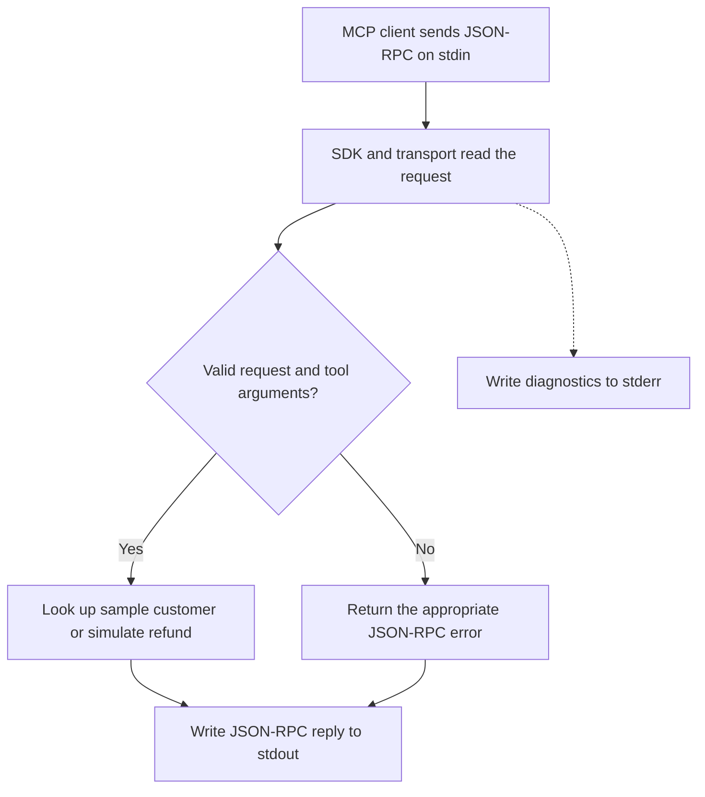
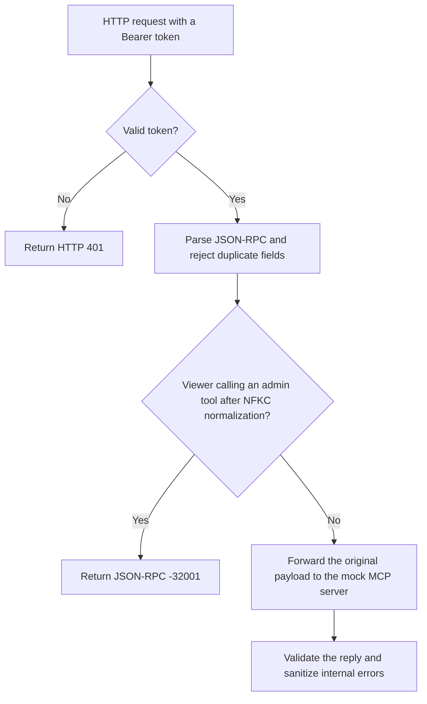
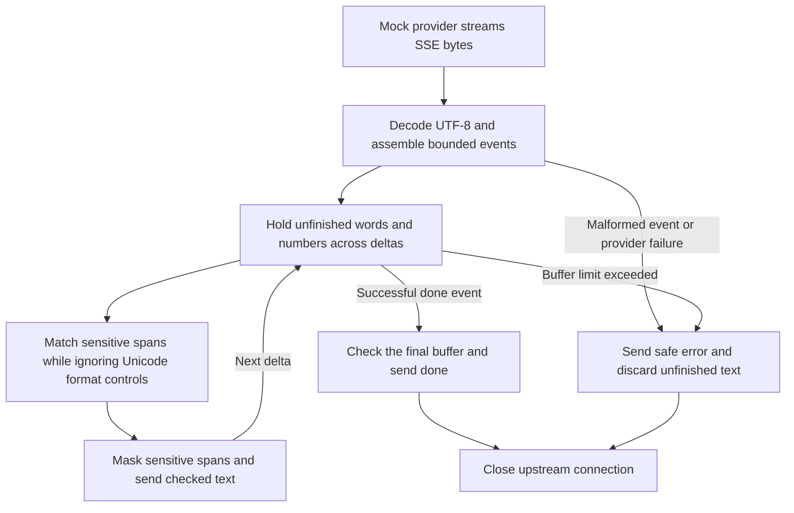
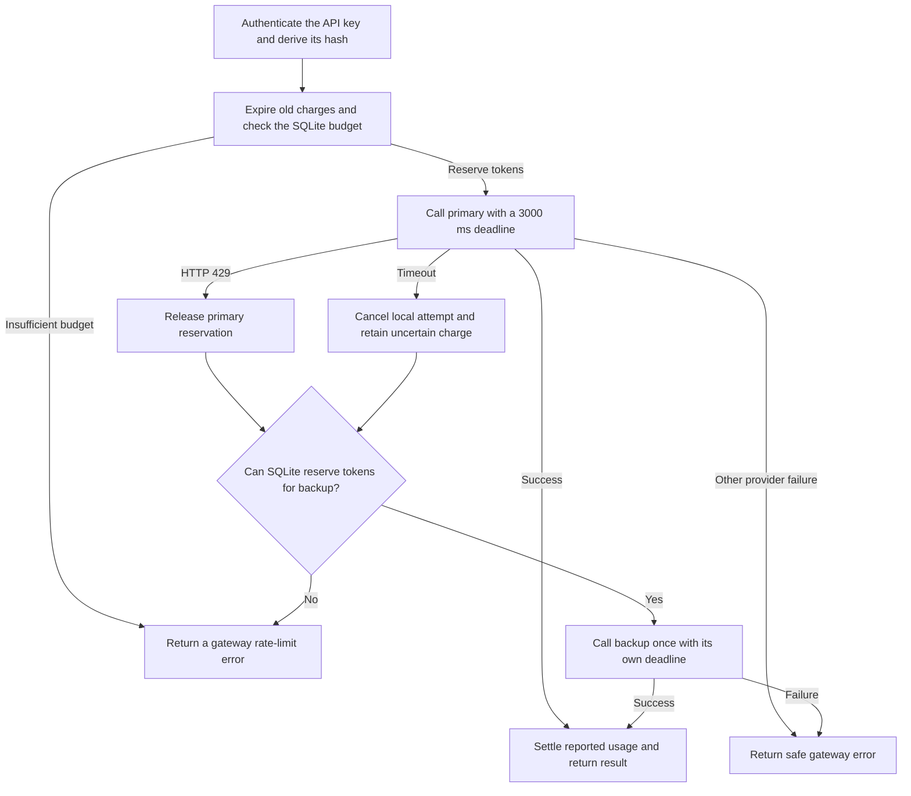

# AI Field Developer Assessment

Four Python tasks about MCP servers and AI gateways. Each task has its own code, tests, and setup steps.

| Task | What it does | Status |
| --- | --- | --- |
| [1. MCP server](task-1-mcp-server/) | Checks customer and refund inputs. Uses stdio to talk to an MCP client. | Implemented; 44 tests passed locally |
| [2. MCP security gateway](task-2-mcp-gateway/) | Checks the user's role before allowing admin tools. | Implemented; 77 tests passed locally |
| [3. Streaming guardrail](task-3-streaming-guardrail/) | Removes personal information while the response streams. | Implemented; 154 tests passed locally |
| [4. Model router](task-4-model-router/) | Limits token use and switches providers when needed. Uses SQLite. | Implemented; 67 tests passed locally |

## Task walkthroughs

Each diagram shows where a request is checked, what happens when it fails, and what a client can observe. The test counts above refer to the recorded local runs.

### Task 1 — MCP customer server

The server exposes `get_customer_record` and `trigger_refund` over stdio using the official MCP SDK. It validates inputs before looking up a sample customer or producing a simulated refund receipt.



| Check | Implementation and evidence |
| --- | --- |
| Input validation | Strict schemas require `CUST-` plus five ASCII digits, a positive finite refund amount, and a reason of at least 10 characters after trimming. Tests verify that invalid arguments never reach the tool implementation. |
| Protocol correctness | Malformed JSON, unknown methods, and invalid parameters produce distinct JSON-RPC errors. A valid but missing customer produces a tool execution error. Tests cover malformed UTF-8 recovery and interoperability with the official SDK client. |
| Observability | Startup, shutdown, and rejection diagnostics go to `stderr`. Subprocess tests capture both pipes and verify that concurrent replies on `stdout` remain valid JSON-RPC frames. |

[Setup](task-1-mcp-server/README.md) · [Test evidence](task-1-mcp-server/TEST_RESULTS.md)

### Task 2 — MCP security gateway

The gateway authenticates the caller and checks tool permissions before forwarding an HTTP JSON-RPC request. This is where the gateway can prevent an unauthorized tool from running.



| Check | Implementation and evidence |
| --- | --- |
| Parser and credential handling | The gateway rejects duplicate JSON keys and compares configured tokens with `hmac.compare_digest`. Tests verify that client authorization headers and cookies are kept out of downstream requests. |
| Unicode authorization | Review identified that a full-width alias could evade a raw `admin_` prefix check if a downstream server normalized the name. The gateway now checks the case-sensitive prefix after NFKC normalization. The regression test verifies that the viewer call is blocked before forwarding and that the admin request retains its original tool name. |
| Error isolation | Private details are removed from downstream `-32603` errors. Unexpected gateway failures return HTTP 500 with a safe JSON-RPC `-32603` frame and the validated request ID. Tests cover both paths. |
| Observability | `/health` reports liveness. Gateway logs identify blocked calls, timeouts, connection failures, and unexpected errors. A test verifies that the authorization token stays out of the denial log. |

[Setup](task-2-mcp-gateway/README.md) · [Test evidence](task-2-mcp-gateway/TEST_RESULTS.md) · [PR #1](https://github.com/VenkateswarluNagineni/ai-field-developer-assessment/pull/1)

### Task 3 — Streaming PII guardrail

The gateway reads server-sent events (SSE) from a mock provider. It holds unfinished words and numbers because a later chunk can complete a sensitive value. Checked text can reach the client while generation continues.



| Check | Implementation and evidence |
| --- | --- |
| Unicode evasion | Detection ignores Unicode format controls and maps each match back to the original text, so an invisible separator inside a card number is masked with the digits. Tests split obfuscated values at every two-chunk boundary and verify that ordinary joined emoji are preserved. |
| Punctuation and SSN formats | Review led to preserving trailing `.`, `!`, and `?` after masked emails and covering space-delimited SSNs such as `123 45 6789`. Both have split-chunk regression tests. The conservative policy can also mask long numeric IDs and tokens such as `A@B`. |
| Latency and memory | Unfinished candidates have a 512-character limit, and SSE events have a separate 64 KiB parsing budget. A real HTTP test verifies that checked text arrives before the provider finishes. A backpressure test verifies that a slow client slows upstream reads. |
| Observability and cleanup | `/health` reports liveness. Clients distinguish normal `done` events from safe `error` events. Tests exercise malformed events, timeouts, disconnects, and upstream connection cleanup. |

[Setup](task-3-streaming-guardrail/README.md) · [Test evidence](task-3-streaming-guardrail/TEST_RESULTS.md) · [PR #2](https://github.com/VenkateswarluNagineni/ai-field-developer-assessment/pull/2)

### Task 4 — SQLite token limiter and model router

The router reserves tokens before each provider attempt. The default budget is 50,000 tokens per API key over the preceding 60 seconds. SQLite makes the budget check and reservation atomic so concurrent calls cannot spend the same capacity.



| Check | Implementation and evidence |
| --- | --- |
| SQLite locking and WAL | Both were already present during review. Connections wait up to two seconds for a lock. WAL supports concurrent readers, and `BEGIN IMMEDIATE` serializes the budget check and reservation. Separate tests exercise 40 concurrent calls and two worker processes sharing one database. |
| Accounting and fallback | A primary `429` releases its reservation. A timeout retains the charge because upstream usage is uncertain. The backup needs its own reservation. Tests cover the three-second deadline, local cancellation, and rejection before backup when the budget is exhausted. The deadline applies per attempt. |
| Data protection | SQLite stores key hashes, token amounts, reservation IDs, and timestamps. Tests inspect the database for raw keys and prompts and verify that client credentials stay out of provider requests. |
| Observability and persistence | `/health`, safe error codes, returned provider and usage fields, and the SQLite ledger make outcomes visible. A real HTTP test restarts the gateway and verifies that recent usage still counts. The mock provider contract uses UTF-8 byte length for input token budgeting. |

[Setup](task-4-model-router/README.md) · [Test evidence](task-4-model-router/TEST_RESULTS.md) · [PR #3](https://github.com/VenkateswarluNagineni/ai-field-developer-assessment/pull/3)

## Start Task 1

Install Python 3.11 or newer and [uv](https://docs.astral.sh/uv/getting-started/installation/). Then:

```sh
git clone https://github.com/VenkateswarluNagineni/ai-field-developer-assessment.git
cd ai-field-developer-assessment/task-1-mcp-server
uv sync --locked
uv run --locked server.py
```

The server waits for an MCP client. It writes logs to stderr. It writes only JSON-RPC messages to stdout.

Run the tests:

```sh
uv run --locked pytest -q
```

Task 1 uses sample customers and simulated refunds. It does not transfer money.

## How we work

- Finish and test one task at a time.
- Keep code small and names clear.
- Explain the logic in plain language.
- Test the requirements and important failure cases.
- Keep credentials, local files, and generated data out of Git.

See [CONTRIBUTING.md](CONTRIBUTING.md) for the repository rules and each task's README for its current scope and setup.
